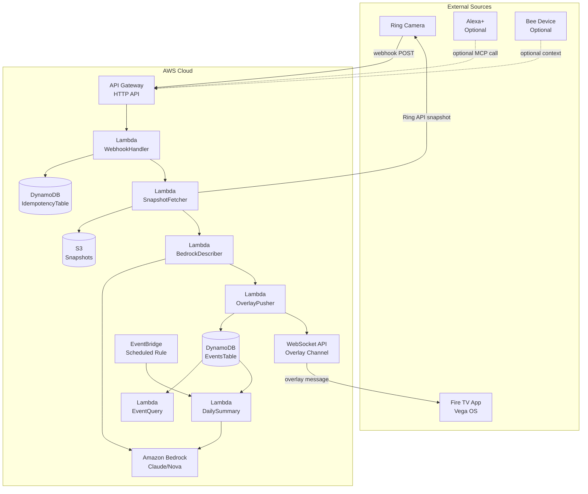

# Front Door Intelligence — Technical Architecture

| Field | Value |
|---|---|
| **Version** | 2.1 (Corrected) |
| **Date** | October 16, 2026 |
| **Architecture Style** | Event-Driven Serverless Pipeline with Optional Cross-Track Adapters |
| **Cloud Provider** | AWS |
| **Primary Track** | Ring, Fire TV |
| **Mini-Challenges** | AWS Builder, Open Source |

---

## 1. Architecture Overview

Front Door Intelligence is an event-driven serverless pipeline. A Ring webhook triggers a chain of Lambda functions that fetch a snapshot, generate an AI description via Bedrock, and push a non-intrusive overlay to a Fire TV app. All events are persisted for daily summaries. Optional adapters expose the same core through an Alexa+ MCP server and ingest Bee context data.

The architecture is deliberately **linear and debuggable** because the submission must be **live and demoable**, not merely described. Every component has a fallback so the pipeline never fails silently.

---

## 2. System Context Diagram (Mermaid)



---

## 3. Component Details

### 3.1 Ring Webhook Ingress

| Property | Value |
|---|---|
| **Trigger** | Ring Partner API webhook |
| **Endpoint** | `POST /webhook/ring` |
| **Auth** | HMAC-SHA256 signature verification via `X-Signature` header |
| **Idempotency** | Store `request_id` in DynamoDB with TTL; reject duplicates |
| **Response SLA** | HTTP 200 within 5 seconds — the Ring documentation names inline heavy processing as a Common Mistake because it exceeds that budget |
| **Event subtypes** | `data.attributes.sub_type` is **flat**: `motion`, `human`, `vehicle`, `other_motion`. `button_press` is an event `type`, not a subtype |

**Important:** The Ring Partner API sends only a coarse `sub_type` inside `data.attributes`. There are **no bounding boxes and no object labels** in the webhook payload. The webhook handler normalizes this into a structured event object before passing it downstream.

### 3.2 Snapshot Fetcher

| Property | Value |
|---|---|
| **Trigger** | Direct Lambda invoke from WebhookHandler |
| **Ring API call** | `GET /camera/{id}/snapshot` with OAuth bearer token |
| **Token source** | Ring Developer Playground (short-lived, ~30 min) or refresh token flow |
| **Timeout** | 4 seconds (must complete before webhook response) |
| **Output** | Base64-encoded JPEG stored in ephemeral Lambda storage + S3 (optional) |

### 3.3 Bedrock Describer

| Property | Value |
|---|---|
| **Model** | `anthropic.claude-3-haiku` or `amazon.nova-lite-v1` (cost-efficient) |
| **Input** | Base64 snapshot + system prompt |
| **System prompt** | *"Describe only what is visible in this security camera snapshot. Use one sentence. Focus on: people, packages, vehicles, animals. Do not judge or label people. If nothing is identifiable, say 'Nothing identifiable.'"* |
| **Max tokens** | 80 |
| **Temperature** | 0.2 (low creativity, factual) |
| **Fallback** | If Bedrock call fails: `"Person detected at Front Door"` or `"Motion detected at Front Door"` |

**Safety boundary:** The model MUST NOT make judgments about people (e.g., "suspicious person"). It describes actions and objects only. This aligns with Ring's priority category of **access control** and **caretaking**, where responsible AI use is expected.

### 3.4 Overlay Pusher

| Property | Value |
|---|---|
| **Protocol** | WebSocket API (preferred) or Fire TV app polling a local HTTP endpoint |
| **Payload** | `{ event_id, description, snapshot_url, timestamp, device_name }` |
| **Overlay behavior** | PiP appears, auto-dismiss after 15s, dismissible via remote |
| **Vega OS API** | Custom React Native overlay component; must NOT pause or interrupt current playback |
| **Vega compatibility** | Vega OS is Linux-based, uses React Native with New Architecture (Turbo Native Modules), and does **not** recognize Android files |

### 3.5 Event Store (DynamoDB)

| Table | Partition Key | Sort Key | TTL | Purpose |
|---|---|---|---|---|
| `EventsTable` | `date` (YYYY-MM-DD) | `timestamp#event_id` | 90 days | Store all processed events |
| `IdempotencyTable` | `request_id` | — | 24 hours | Prevent duplicate processing |

**Event item schema:**

```json
{
  "date": "2026-10-15",
  "event_id": "evt_abc123",
  "timestamp": "2026-10-15T14:32:00Z",
  "device_id": "front_door_cam",
  "device_name": "Front Door",
  "event_type": "motion_detected",
  "sub_type": "human",
  "description": "Amazon delivery driver placed a medium box",
  "snapshot_s3_key": "snapshots/2026-10-15/evt_abc123.jpg",
  "bedrock_model": "anthropic.claude-3-haiku",
  "latency_ms": 4200,
  "processed": true
}
```

### 3.6 Daily Summary Generator

| Property | Value |
|---|---|
| **Trigger** | EventBridge scheduled rule (daily at 9:00 PM local) |
| **Input** | All events for the current day from `EventsTable` |
| **Bedrock prompt** | *"Summarize today's front door activity in 2-3 sentences for a homeowner. Include: number of events, types (deliveries, visitors, vehicles), and any notable patterns."* |
| **Output** | Written to `EventsTable` as a `summary` item + optional email via SES |

### 3.7 Optional Cross-Track Adapters

These are **supporting integrations**, not separate primary-track submissions. They demonstrate depth without requiring four separate apps.

| Adapter | Technology | Purpose |
|---|---|---|
| **Alexa+ MCP Server** | Self-hosted MCP server (spec 2025-11-25+, Streamable HTTP) | Expose `get_latest_door_event` as a voice tool |
| **Bee Context Ingest** | Bee CLI / MCP / Agent Skill | Trigger a "check front door" reminder when the user arrives home |

**Track eligibility.** Rules §4 requires the project to be built "into **the following primary
tracks**" and then lists all four. **Nothing in the Rules restricts how many tracks a project may
be entered into.** The only constraint is on prizes, under "Important Notes on Multiple Prize
Eligibility":

> "A project can only win **one (1) track prize** and one (1) mini challenge prize." — Rules §8

The limit is on prizes *won*, not tracks *entered*. The submission form asks "which **track(s)**
and mini challenge(s) you're entering", and Rules §4 reserves the right to "reassign a Project
from one Category or Mini Challenge Prize to another". A DevRel confirmation on the hackathon
forum (Emerson Sklar) states it directly: *"your project can select and be judged for both tracks
(and, as you noted, can only win one)."*

**This project enters Ring and Fire TV.** Both clauses are already built: the Ring APIs are called
at runtime in code (FR1–FR8), and the overlay client is a dependency-free page designed to load in
the transparent `@amazon-devices/webview` that Vega OS sanctions (FR13–FR15, D034). The cost of
the second entry is one demo video that satisfies both tracks' clauses — Ring through a simulator
or an actual device, Fire TV running on an actual device or the Fire TV/Vega simulator.

---

## 4. Data Flow

### 4.1 Real-Time Event Flow (Happy Path)

```
Ring Camera detects motion
        │
        ▼
Ring Partner API sends webhook POST
        │
        ▼
API Gateway → Lambda: WebhookHandler
        │
        ├── Verify HMAC-SHA256 signature
        ├── Check idempotency (DynamoDB)
        ├── Parse event subtype from data.attributes
        │
        ▼
Lambda: SnapshotFetcher
        │
        ├── Ring API: GET /camera/{id}/snapshot
        ├── Store base64 JPEG
        │
        ▼
Lambda: BedrockDescriber
        │
        ├── Invoke Bedrock with snapshot + prompt
        ├── Receive one-sentence description
        │
        ▼
Lambda: OverlayPusher
        │
        ├── Send WebSocket message to Fire TV app
        ├── Store event in DynamoDB
        ├── Upload snapshot to S3
        │
        ▼
Fire TV displays PiP overlay
```

### 4.2 Query Flow (Dashboard)

```
User opens Web Dashboard
        │
        ▼
GET /events/today
        │
        ▼
Lambda: EventQuery
        │
        ├── Query DynamoDB by date = today
        ├── Return JSON array of events
        │
        ▼
Dashboard renders timeline
```

---

## 5. API Contracts

### 5.1 `POST /webhook/ring`

**Request headers:**

| Header | Value |
|---|---|
| `Content-Type` | `application/json` |
| `X-Signature` | HMAC-SHA256 hex digest |

**Request body (from Ring):**

```json
{
  "request_id": "req_xyz789",
  "event_type": "motion",
  "data": {
    "id": "evt_abc123",
    "device_id": "front_door_cam",
    "device_name": "Front Door",
    "attributes": {
      "sub_type": "human"
    },
    "created_at": "2026-10-15T14:32:00Z"
  }
}
```

**Response (200):**

```json
{
  "status": "accepted",
  "event_id": "evt_abc123"
}
```

### 5.2 `GET /events/today`

**Response (200):**

```json
{
  "date": "2026-10-15",
  "count": 3,
  "events": [
    {
      "event_id": "evt_abc123",
      "timestamp": "2026-10-15T14:32:00Z",
      "device_name": "Front Door",
      "event_type": "motion_detected",
      "sub_type": "human",
      "description": "Amazon delivery driver placed a medium box",
      "snapshot_url": "https://s3.amazonaws.com/.../evt_abc123.jpg"
    }
  ]
}
```

---

## 6. Security

| Concern | Mitigation |
|---|---|
| **Webhook forgery** | HMAC-SHA256 signature verification on every request |
| **Replay attacks** | Idempotency table with `request_id` TTL |
| **API key exposure** | Environment variables; `.env.example` in repo; no secrets committed |
| **Ring token expiration** | Refresh token flow with retry logic |
| **Bedrock cost runaway** | Max tokens = 80; temperature = 0.2; CloudWatch billing alarm |
| **S3 snapshot privacy** | Pre-signed URLs with 1-hour expiry; bucket not public |
| **IAM least privilege** | Each Lambda has its own role with only required permissions |

---

## 7. AWS Services Used

| Service | Purpose | Mini-Challenge |
|---|---|---|
| **API Gateway (HTTP API)** | Webhook ingress + REST endpoints | — |
| **Lambda** | All compute (6 functions) | — |
| **DynamoDB** | Event store + idempotency | — |
| **Amazon Bedrock** | AI description generation | ✅ AWS Builder |
| **S3** | Snapshot storage | — |
| **EventBridge** | Scheduled daily summary | — |
| **CloudWatch** | Logs, metrics, alarms | — |
| **SES** | Optional daily summary email | — |
| **WebSocket API** | Real-time overlay push to Fire TV | — |

**Kiro Crew qualification:** If used during development, document it in the Friction Log and README. Building with Kiro Crew alone qualifies for the AWS Builder mini-challenge.

---

## 8. Deployment

### 8.1 Prerequisites

```bash
# Install AWS SAM CLI
brew install aws-sam-cli

# Install Vega SDK (for Fire TV app)
# Follow: https://developer.amazon.com/docs/vega/

# Configure AWS credentials
aws configure
```

### 8.2 Environment Variables

```bash
# .env.example
RING_CLIENT_ID=your_ring_client_id
RING_CLIENT_SECRET=your_ring_client_secret
RING_REFRESH_TOKEN=your_refresh_token
RING_WEBHOOK_SECRET=your_webhook_hmac_secret
AWS_REGION=us-east-1
BEDROCK_MODEL_ID=anthropic.claude-3-haiku-20240307-v1:0
DYNAMODB_EVENTS_TABLE=FrontDoorEvents
DYNAMODB_IDEMPOTENCY_TABLE=FrontDoorIdempotency
S3_SNAPSHOT_BUCKET=front-door-snapshots
```

### 8.3 Deploy Commands

```bash
# Deploy backend
sam build && sam deploy --guided

# Deploy Fire TV app (Vega OS)
# Follow Vega SDK build + sideload instructions
```

---

## 9. Local Development

### 9.1 Running the Backend Locally

```bash
# Install dependencies
npm install

# Start local API Gateway + Lambda
sam local start-api

# Test webhook
curl -X POST http://localhost:3000/webhook/ring \
  -H "Content-Type: application/json" \
  -H "X-Signature: <computed_hmac>" \
  -d @test/fixtures/ring_motion_event.json
```

### 9.2 Testing with MCP Inspector (Alexa+ Optional)

```bash
# If Alexa+ MCP integration is implemented
npx @modelcontextprotocol/inspector
# Connect to http://localhost:3000/mcp using Streamable HTTP
```

### 9.3 Fire TV Overlay Testing

```bash
# Requires Fire TV Stick running Vega OS
# Or use Vega virtual device
vega run --device virtual
```

---

## 10. Friction Log Template

Create `FRICTION_LOG.md` in repo root with this structure. **The Official Rules §6 define a
six-field enum, and the six-field shape is required** — a four-field template loses the
entry:

```markdown
# Friction Log — Front Door Intelligence

## Ring API

### Entry 1: Webhook signature verification docs incomplete
- **Task attempted:** Verify Ring's `X-Signature` HMAC-SHA256 header on every webhook request
- **Steps taken:** Followed Ring's webhook setup guide and computed the digest from parsed JSON
- **Expected vs actual:** Expected any canonical JSON serialisation to produce the same digest.
  Actually the HMAC covers the raw request body bytes, so re-serialising changed the bytes and
  every request failed verification with a payload that looked correct
- **Severity rating:** High — FR2 is a MUST and a check that fails 100% of the time looks like
  a bad secret, not a serialisation bug
- **Workaround used:** Verify against the untouched body string; parse only after the digest
  matches. Implemented in `readRawBody()` and `signatureVerifier.ts`
- **Actionable suggestion:** Add a Node.js code example to the Ring webhook documentation and
  state the digest encoding explicitly

## Vega SDK

### Entry 2: ...
```

**Severity rating scale.** `High`: blocked a requirement or invalidated planned architecture.
`Medium`: cost hours or forced a design change. `Low`: cost under an hour or produced a code
comment.

The Friction Log is **recommended** for **up to a 10% bonus** — it is not automatic. Per Rules
§6, Amazon's internal review team assesses the entries during **Stage 1 downselection** and
passes a *recommended* bonus to the Stage 2 judging panel, which applies it to the final
spreadsheet score. A log that does not clear Stage 1 is never scored at all.

---

## 11. Repository Structure

```
front-door-intelligence/
├── docs/
│   ├── PRD.md
│   ├── ARCHITECTURE.md
│   └── FRICTION_LOG.md
├── src/
│   ├── handlers/
│   │   ├── webhookHandler.ts
│   │   ├── snapshotFetcher.ts
│   │   ├── bedrockDescriber.ts
│   │   ├── overlayPusher.ts
│   │   ├── eventQuery.ts
│   │   └── dailySummary.ts
│   ├── lib/
│   │   ├── ringClient.ts
│   │   ├── bedrockClient.ts
│   │   ├── dynamoClient.ts
│   │   └── signatureVerifier.ts
│   └── types/
│       └── index.ts
├── firetv/
│   ├── App.tsx
│   ├── components/
│   │   └── Overlay.tsx
│   └── package.json
├── web/
│   ├── src/
│   │   ├── App.tsx
│   │   └── components/
│   │       └── EventTimeline.tsx
│   └── package.json
├── test/
│   ├── fixtures/
│   │   └── ring_motion_event.json
│   └── handlers.test.ts
├── template.yaml          # AWS SAM template
├── .env.example
├── README.md
├── LICENSE                 # MIT
└── package.json
```

---

## 12. Risks & Mitigations

| Risk | Likelihood | Impact | Mitigation |
|---|---|---|---|
| Ring API rate limiting | Medium | High | Cache snapshots; exponential backoff |
| Bedrock cold start latency | Medium | Medium | Use provisioned concurrency or accept 8s SLA |
| Vega OS overlay API unavailable | High | High | No documented PiP/heads-up API exists; deliver through a transparent `@amazon-devices/webview` (D021) |
| Vega OS device testing blocked | Low | Medium | FAQs permit an emulator at every stage of submission and judging; no physical device required |
| Webhook signature verification fails | Medium | High | Test with Ring sandbox; log raw headers |
| Time runs out before demo | Medium | Critical | Build MVP first (Ring → Bedrock → web dashboard), add TV overlay last |
| Public repo leaks secrets | Low | Critical | Pre-commit hook scanning for API keys; `.gitignore` `.env` |

---

## 13. Timeline (26 Days)

| Week | Dates | Focus |
|---|---|---|
| **Week 1** | Sep 28 – Oct 4 | Ring webhook + snapshot fetcher + Bedrock describer (MVP pipeline) |
| **Week 2** | Oct 5 – Oct 11 | DynamoDB event store + web dashboard + Friction Log |
| **Week 3** | Oct 12 – Oct 18 | Fire TV overlay (Vega OS) + polish + demo video recording |
| **Week 4** | Oct 19 – Oct 24 | Final testing, submission, public repo setup, Devpost form |

---

## 14. Judging Alignment

### Stage One — a pass/fail viability gate, not a score

Rules §6: the first stage "will determine via **pass/fail** whether the ideas meet a
**baseline level of viability**, in that the Project reasonably fits the theme and reasonably
applies the required APIs/SDKs featured in the Hackathon."

This is an elimination cliff, not a weighting. A submission that does not clearly apply the
track's API does not reach Stage Two. Two consequences for this project:

- **Ring requires the Ring APIs to be called at runtime in code**, not named in a README
  (Rules §4, requirement 6). Fire TV is the exception — any framework is fine provided the demo
  shows it running on a device or simulator.
- The Friction Log bonus is assessed **during** Stage One, so an entry set that fails to
  demonstrate real friction never reaches a panel that could score it.

### Stage Two — four equally weighted criteria

Rules §6, verbatim:

| Criterion | How This Project Wins |
|---|---|
| **Tech Implementation** | Live Ring API + Bedrock + DynamoDB + Fire TV pipeline |
| **Design** | Non-intrusive overlay; one-glance comprehension, ten-foot UI |
| **Potential Impact** | Reduces alert fatigue; serves remote workers, caregivers, families |
| **Quality of the Idea** | Creative use of the Ring "non-security use case" direction the rubric names — package/delivery management and care-taking monitoring rather than a richer motion alert |

Note on the last row: the Ring rubric draws an explicit line, listing "motion detection alert,
basic doorbell live view" as **Obvious** and "package/delivery management", "care-taking
monitoring", "multi-camera pipeline", "event-based triggers" as **Creative**. This project
belongs in the second list, and the demo path should be built to show it.

### Not criteria

| | |
|---|---|
| **Friction Log Bonus** | Recommended up to 10%, assessed at Stage 1 downselection (§10) |
| **AWS Builder** *(mini)* | Documented Bedrock + Lambda + DynamoDB integration, described in the Product Feedback answer |
| **Open Source** *(mini)* | Separate licensed repository alongside the submission (§10 of the submission form asks for two distinct URLs) |

---

## 15. What Changed From v1 (Correction Log)

| Issue in v1 | Correction in v2 |
|---|---|
| SNS used as async trigger between Lambdas | Replaced with direct Lambda invoke + WebSocket API for overlay push |
| "Vega OS API: KeplerCaptionsView" cited as overlay API | Vega OS overlay is a custom React Native component; KeplerCaptionsView is for closed captions, not overlays |
| Asserted one app = one primary track, which no rule supports | **Removed 2026-10-16.** Re-verified against the live Rules: §4 lists all four primary tracks and imposes no entry limit, and §8 limits only prizes *won*. Dual-track entry recorded instead; see §3.7 |
| Ring webhook payload implied bounding boxes/labels | Corrected: Ring sends only `sub_type`; no bounding boxes or labels |
| Missing WebSocket API for real-time overlay | Added WebSocket API as the preferred real-time push mechanism |
| Missing Kiro Crew qualification note | Added: Kiro Crew alone qualifies for AWS Builder |
| Missing Friction Log bonus citation | Added: up to 10% bonus |